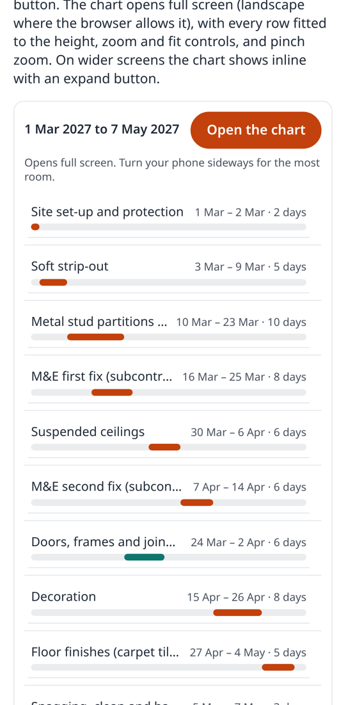
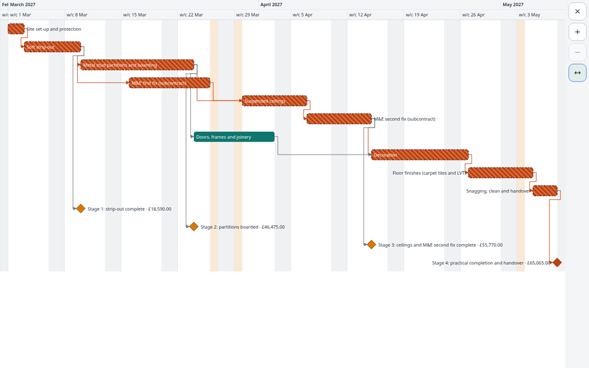
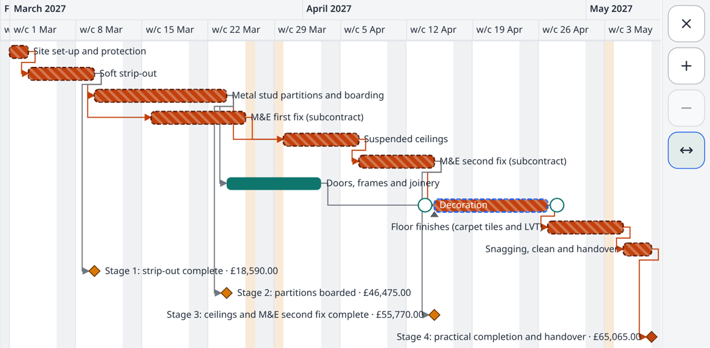
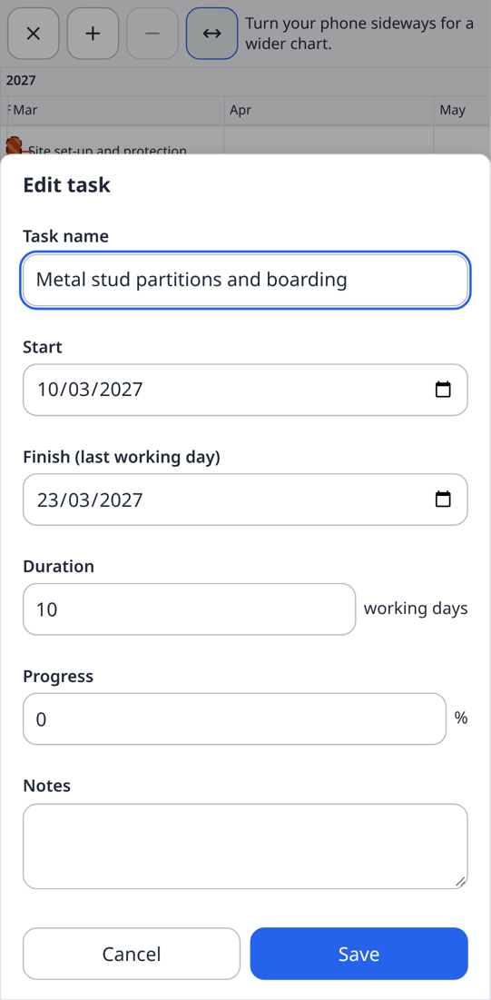

# 0011. A phone summary in place of the chart, and full screen on every screen size

- **Status:** Accepted
- **Date:** 2026-10-09
- **Deciders:** Ben Atkinson (Streamlined Analytics)
- **Feature / area:** mobile, layout, touch, accessibility, bundle size
- **Builds on:** ADR-0010 (timeline layout and fit-to-width), ADR-0002 (treegrid and SVG timeline)
- **Supersedes / Superseded by:** none

## What problem were we trying to solve?

The first real use of the library is a public demo page: 14 rows (10 tasks and 4 stage payments) over about ten weeks, in the
timeline layout fitted to the width (ADR-0010). On a phone held upright it is embedded about
420 px tall and 360 to 390 px wide. There, each week is about 35 px wide, bars and labels crowd
each other, and the chart scrolls vertically inside a page that also scrolls, so a thumb
dragging down the page gets caught in the chart. The goal was a chart that works as well as
possible on a phone, with a good UI around it, even if that means it only shows in landscape
mode on phones.

The core bundle had 0.85 KB of its 45 KB gzip budget left, and the script-tag build 1.4 KB of
48 KB, so a phone experience of any size could not go into either.

## What did we look at?

- **Bryntum Gantt** offers responsive levels (CSS classes and column sets per width) and a
  `requestFullscreen` on its widgets; touch drag on bars has had open bugs on touch laptops.
- **DHTMLX Gantt** and **Frappe Gantt** shrink the same chart; neither has a distinct phone view.
- **Microsoft Planner / Project for the web**, **Monday** and **TeamGantt** phone apps show a
  task list (or board) with dates on a phone and keep the timeline for wider screens or
  landscape.
- **iPhone Safari** still has no element fullscreen (iPad and desktop Safari do) and no
  `screen.orientation.lock()`, which needs fullscreen anyway. Android Chrome has both, within a
  user gesture.

The pattern the phone apps share is the one we chose: a readable list when upright, the real
timeline when there is room.

## What did we try?

### Attempt 1: a squashed, read-only chart behind a "rotate to edit" overlay ❌ rejected

It looks like a Gantt chart in a screenshot, but labels are illegible at 35 px a week and the
overlay hides it anyway. It answers "is there a chart here?", not "what is the programme?".

### Attempt 2: a summary list in place of the chart ✅ chosen

Below `breakpoint` (600 px of host width) the chart is hidden and a summary takes its place: the
programme's dates, an **Open the chart** button, and one row per task with its name, its dates
and duration, and a mini bar on a shared track (a diamond for milestones; critical, summary,
payment and per-item colours as on the chart). It has no fixed height and no inner scroll, so the
page scrolls normally. Each row is a button that opens the chart at that task. It is built from
the chart's own rows (`rows()`, `taskState()`, `appearanceOf()`, `labelFor()`), so filters,
categories and payment values match.

The summary is its own `.sg-root` element next to the chart, not a child of it. That way a host
rule written for the chart (`[data-gantt-host] .sg-root { --sg-bar: … }`) also themes the
summary, and the chart's fixed height does not apply to it. It copies the chart's colour-scheme
classes and inline theme tokens.

### Full screen, attempt 1: move the chart to `<body>` with `position: fixed` ❌ rejected

Escapes ancestors that clip or transform it, but the host's theme selectors
(`[data-gantt-host] .sg-root`) stop matching, so the chart loses its brand when it opens.

### Full screen, attempt 2: `position: fixed` on the host ❌ rejected

Keeps the theme, but any ancestor with a `transform`, `filter` or `contain` (common in page
builders) turns `fixed` into "relative to that ancestor", and `z-index` fights with sticky
headers.

### Full screen, attempt 3: a modal `<dialog>` inside the host, plus document fullscreen ⚠️ replaced

`open()` moved the chart into a `<dialog>` inside the host and called `showModal()`. The top
layer meant no ancestor could clip it, it stayed a DOM descendant of the host so theme selectors
kept matching, and the modal gave a focus trap and Escape. On touch screens it also asked for
fullscreen on `<html>`, showing the dialog only after the request settled (shown earlier, the
fullscreen `<html>` entered the top layer after it and painted over it). This was the first
version of this PR.

Ben then asked for full screen as a general feature on every screen size, using the Fullscreen
API on the component, with a keyboard shortcut and a JavaScript API. Two findings changed the
design: Chromium refuses fullscreen on a `<dialog>` ("Dialog elements are invalid"), so the
dialog cannot itself be the fullscreen element; and fullscreening `<html>` on a desktop takes
the whole page, not the chart.

### Full screen, attempt 4: the Fullscreen API on a stage element, the dialog as fallback ✅ chosen

`open()` moves the chart into a plain stage element inside the host. Where the Fullscreen API
exists (desktops, Android, iPad) the stage itself goes fullscreen, labelled as a modal dialog
(`role="dialog"`, `aria-modal`). Theme selectors still match, and the stage is in the top layer.
On touch screens it then asks for `screen.orientation.lock("landscape")`. The API gives no focus
trap, so focus that leaves the stage is put back on the close button. Escape, or leaving
fullscreen from the browser (its own Escape handling, Android's back gesture), closes the chart.
Where there is no API (iPhone), or the request is refused (no user gesture, a permissions policy),
the stage goes into the modal `<dialog>` from attempt 3, with the page's scroll locked. On a phone
held upright a short "Turn your phone sideways" hint shows in the rail (CSS only: portrait and a
coarse pointer).

Opening switches the chart to fit-to-width and closing restores its zoom. The full-screen button
sits in the built-in toolbar (labelled **Full screen**) when there is one, else in the chart's
corner, and `expandButton: false` hides it. `F` (or Shift + F) toggles full screen while focus is
in the chart and not in a field, menu or dialog; it was the only free single key (the treegrid
has no type-ahead). The `Gantt` class gets `enterFullscreen()`, `exitFullscreen()`,
`toggleFullscreen()` and `isFullscreen`, which delegate to the add-on and reject with a clear
message without it. Testing it found that `updateRootState()` rewrote the root's classes and
dropped `sg-fullscreen` whenever fit or zoom changed, so the core now keeps that class while full
screen.

The event is `fullscreen-change` (DOM `gantt:fullscreen-change`), not `fullscreenchange`, to match
every other event in the catalogue (`zoom-change`, `lookahead-change`).

Full screen, rows are fitted to the height: `floor((height − header) / rows)`, between
`minRowHeight` (24 px, the WCAG 2.5.8 target size) and `maxRowHeight` (44 px), refitted on every
resize and orientation change. The 14-row sample fits a Pixel 7 in landscape at 26 px rows with
no vertical scroll. A rail (down the side in landscape, where width is spare and the notch is;
across the top in portrait) holds close, zoom in, zoom out and fit, each 44 px. Zooming out past
the level that fits the width switches back to fit-to-width; two fingers pinch to zoom a step at
a time (only in the dialog: the page's own pinch zoom is left alone elsewhere). Safe-area insets
pad the chart clear of the notch and home indicator. Closing restores the row height, the
chart's `--sg-height`, fit-to-width, the page's scroll and focus.

### Touch ergonomics (core)

- Bars' move targets on touch are now the full row height and at least 44 px wide (milestones
  too), and the resize handles are 32 px (were 24) and reach outwards, with at most a quarter of
  the bar's width inside it, so a short bar keeps its middle for moving.
- Tap to select, then drag, is unchanged and verified on Pixel (trusted CDP touch), iPhone and
  iPad. Native momentum scrolling is untouched, because drags only start on a selected bar.
- The built-in editor becomes a full-width bottom sheet below 600 px, and on touch screens every
  input and button is at least 44 px tall with 16 px text, so iOS does not zoom into a field.
- The built-in toolbar folds everything after Today behind a **More** button below 560 px (a
  container query on the toolbar).

## What did we land on, and why?

- `streamlined-gantt/mobile` (`mobileView(gantt, options)`, `installMobile(Gantt)`,
  `MobileView`, `MOBILE_STRINGS`) and a script-tag add-on, `mobile.iife.min.js`, which installs
  itself on `StreamlinedGantt.Gantt`. The `mobile` option and the element's `mobile` attribute
  work once it is installed.
- A small core hook, `Gantt.extensions`: functions called with every new chart, so a separately
  loaded add-on can read `gantt.options.mobile`. It costs a few bytes and avoids loading the
  mobile code into the core or the script-tag build.
- Full screen on every size from the add-on: a Full screen button, the `F` key, and
  `gantt.enterFullscreen()` / `exitFullscreen()` / `toggleFullscreen()` / `isFullscreen` in the
  core (delegating to the add-on).
- Two events in the catalogue, `layout-change` and `fullscreen-change`, mirrored on the host as
  `gantt:layout-change` and `gantt:fullscreen-change`.
- Tokens for the host's brand: `--sg-cta-bg`, `--sg-cta-fg`, `--sg-cta-radius`,
  `--sg-preview-track`, `--sg-preview-font-size`, `--sg-rail-bg`, `--sg-touch-target`. All
  mobile CSS lives in the main stylesheet, so hosts add one script, not a stylesheet.
- `prefers-reduced-motion` turns off the dialog's entrance animation.

Sizes (gzip): core 44.38 KB (was 44.15), script-tag build 46.94 KB (was 46.63), CSS 5.09 KB (was
4.02), mobile module 5.27 KB and its script-tag add-on 5.51 KB (8 KB budget each).

## What does this cost us?

- Hosts have to load a second script to get the phone experience and full screen; without it
  nothing changes and `enterFullscreen()` rejects. The module keeps the name `mobile` although
  full screen works everywhere, because phones are why it exists and renaming it would only add
  churn.
- In element fullscreen, focus is kept inside by moving it back rather than by making the page
  inert, so a screen reader's virtual cursor can still reach page content behind the chart.
- The summary is a second rendering of the programme to keep in step with the chart (it
  re-renders on `change` and `load`).
- Below 600 px a page can no longer show the chart inline without `preview: false`.
- On iPhone the "landscape" is a request to the user, not a lock; Safari gives us no way to
  force it. Rows still fit whichever way up the phone is.
- At 24 to 28 px rows a bar's touch target is the row height, below Apple's 44 pt guideline but
  above WCAG 2.5.8's 24 px. Fitting every row on screen was the bigger win; tap-to-select before
  dragging limits mis-hits.
- Pinch zoom steps between zoom levels rather than zooming continuously.
